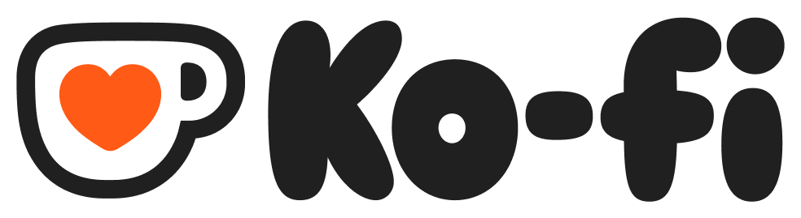

  

# Achievement Companion

Achievement Companion is a Decky Loader plugin for Steam Deck and compatible SteamOS devices in Game Mode. It brings RetroAchievements and Steam progress into the place you are already playing: Quick Access for a quick check, full-screen for a closer look, and selected native Steam screens for the moments when you would rather not open another app.

RetroAchievements is the main focus; Steam achievements are here too. The result is more than a stats dashboard: RA achievements can appear inside Steam's own Your Stuff / Achievements view for supported, confidently matched non-Steam games.

[GitHub project](https://github.com/parvagans/achievement-companion) · [GitHub Releases](https://github.com/parvagans/achievement-companion/releases) · [Report an issue](https://github.com/parvagans/achievement-companion/issues)

No obligatory Trinkgeld — just the optional [beer-money jar on Ko-fi](https://ko-fi.com/parvagans) if you would like to support development.

## Achievements without leaving Game Mode

Open the Quick Access Menu (QAM) when you want a fast look at recent unlocks, profile progress, or the game you are playing. Open the full-screen views when you want to browse profiles, games, achievements, activity, history, and completion in more depth. Both are made for controller use, and you can move between them without leaving Game Mode.

## What it does

- Puts RetroAchievements and Steam in one Decky plugin while keeping each provider's progress and rules distinct.
- Brings RA achievements into Steam's native Your Stuff / Achievements view for supported, safely matched non-Steam shortcuts.
- Adds a separate, clickable achievement-status badge to supported Steam game pages.
- Covers RA profiles, games, achievement details, subsets, activity, history, and completion progress.
- Shows RA Hardcore and Softcore progress, Site or Casual Rank, and Beaten or Mastered states where the data is available.
- Uses fresh RetroAchievements Rich Presence to show when you are actually in a game, rather than guessing from your last-played game.
- Includes Steam profiles, games, unlock history, completion views, manual library scans, and optional SteamHunters information.
- Supports Steam ROM Manager and EmuDeck shortcut matching for supported RA games; uncertain matches stay hidden rather than showing the wrong set.

## RetroAchievements inside Steam

For a supported non-Steam shortcut that Achievement Companion can match to the right RetroAchievements game, its achievement artwork, names, descriptions, locked or unlocked state, and progress can appear in Steam's own Your Stuff / Achievements view. Unlock times and global unlock rates are shown where the RA data provides them.

This is native Steam presentation, not an Achievement Companion page. It is also separate from the small game-page status badge below. Matching is deliberately conservative: if the shortcut and RA game cannot be identified with confidence, Achievement Companion does not add the wrong achievements to Steam.

## See it in action

### RetroAchievements and Steam profiles

### RetroAchievements Games and Activity

The full-screen Games view lets you search and filter your progress. Activity brings together recent unlocks, insights, and a calendar, with the controller footer available across both views.

### RetroAchievements game detail

### Native game-page status badges

## RetroAchievements

The RA views include profile progress, recent unlocks, activity and history, systems, games, and game and achievement details. Completion pages can be filtered to show unfinished, beaten, or mastered games. Achievement pages can show classifications such as Missable, Progression, and Win Condition, plus community and set details where available. Subsets can be explored from supported game pages.

Hardcore and Softcore progress are kept distinct, with a setting to show either mode or both. Profile rank can use Site Rank or Casual Rank. Rich Presence contributes current-game information only while its activity is fresh enough to be useful.

For supported Steam ROM Manager or EmuDeck shortcuts, matching can use platform and title information and, where supported, ROM hashes. The tools create the shortcuts; Achievement Companion reads their metadata to find a safe RA match. Unsupported or ambiguous games are left unmatched.

## Steam

The Steam provider includes profile progress, recently played games, achievements, game detail, activity, and completion views. A manual full-library scan can build broader cached totals for achievement-enabled games. Optional SteamHunters information can add context when it is available; the Steam views do not depend on it.

## Game-page achievement badge

This is separate from Steam's native Your Stuff / Achievements view. The small clickable badge appears on supported Steam game pages and opens the corresponding Achievement Companion detail view.

- **In Progress** is available for supported Steam or RetroAchievements games.
- **Perfected** is a Steam status; **Beaten** and **Mastered** are RetroAchievements statuses.
- The badge can be turned off, moved among six screen positions, and given a color choice for each status.

Non-Steam matching stays cautious here too. If Achievement Companion cannot safely identify the game, it does not show a badge.

## Requirements

- Steam Deck, Steam Machine, or compatible SteamOS device running Game Mode.
- [Decky Loader](https://decky.xyz/).
- A RetroAchievements account and Web API key for RA features.
- A Steam Web API key for Steam features; the signed-in Steam account is detected when possible, with SteamID64 available as a fallback.

## Installation

Until version 1.0.0, manual installation from GitHub Releases is the supported installation method. Decky Store installation is not offered.

1. Download the release ZIP from [GitHub Releases](https://github.com/parvagans/achievement-companion/releases).
2. In Game Mode, open Decky Loader settings and enable **Developer Mode** under **General → Other**.
3. Open the **Developer** tab and choose **Browse for ZIP file** to select the downloaded ZIP, or **Install from URL** and enter the direct ZIP URL.
4. Install the plugin, restart the Deck if needed, then open Achievement Companion from Decky.
5. Connect RetroAchievements and/or Steam from the provider setup screens.

This README describes the current project. Check a release's notes to see which features are included in that ZIP.

### Provider setup

For RetroAchievements, enter your username and the Web API key from RetroAchievements **Settings → Authentication**. For Steam, enter a Web API key; if the signed-in account is not detected automatically, enter its SteamID64.

## Updates

Achievement Companion can check GitHub Releases automatically (about once a day while it is running) or on demand from **Settings → About**. It verifies a downloaded update before asking Decky to confirm installation; updates are not installed unattended.

## Privacy

Provider requests go to the services needed for the features you use: RetroAchievements, Steam, GitHub Releases for update checks, and SteamHunters only when its optional enrichment is used. Achievement Companion does not require a separate project server. API keys are handled by Decky's backend instead of browser storage, and logs redact secret-like values. Local secret protection is not a defence against a compromised device, so rotate a key at its provider if you think the Deck itself is compromised.

## Help and support

If something looks wrong, [open a GitHub issue](https://github.com/parvagans/achievement-companion/issues) with the provider and page involved and enough detail to reproduce it. Never include an API key.

Achievement Companion is an independent community project, not affiliated with RetroAchievements, Decky, Valve, or Steam. It does not provide games, ROMs, or BIOS files, unlock achievements, or modify games.

## Support Achievement Companion

If it has made the Game Mode achievement loop nicer, you can leave a star on GitHub or send entirely optional [Trinkgeld / beer money through Ko-fi](https://ko-fi.com/parvagans). Feedback and bug reports are every bit as useful.

## License and notices

Achievement Companion is released under the [BSD-3-Clause License](LICENSE). Third-party dependency notices are in [THIRD_PARTY_NOTICES.md](THIRD_PARTY_NOTICES.md).
