

  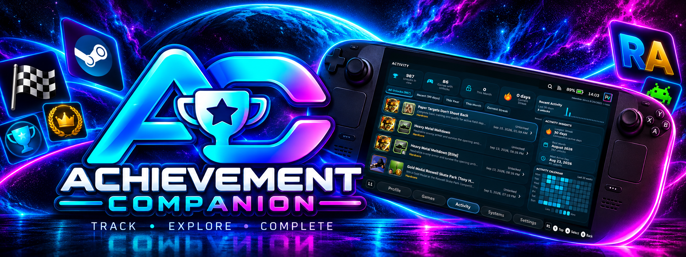

# Achievement Companion

  
  
  
  

  

  <strong>Your retro milestones. Your Steam completions. All in Game Mode.</strong>

  <a href="#installation"><strong>Install Achievement Companion</strong></a>
  ·
  <a href="https://github.com/parvagans/achievement-companion/releases/latest">Latest GitHub release</a>

Achievement Companion brings RetroAchievements and Steam achievement tracking to Steam Deck and compatible SteamOS devices through Decky Loader. Check your next unlock in Quick Access, explore your collection in full-screen dashboards, and see completion badges on library game pages.

The project is undergoing active, rigorous development with frequent updates. If you find a problem or have an idea, please [open a GitHub issue](https://github.com/parvagans/achievement-companion/issues). Never include an API key in an issue.

  

## Highlights

- **Quick Access and full-screen views:** controller-friendly profiles, searchable game lists, completion progress, activity calendars, and achievement details.
- **RetroAchievements inside Steam:** supported non-Steam games can show RetroAchievements in Steam's native Your Stuff and Activity views.
- **Steam completion insights:** SteamHunters community data adds rarity, completion times, DLC requirements, achievement groups, and obtainability information where available.
- **Optional SteamHunters personal data:** personal SteamHunters profile statistics can be disabled without turning off community statistics. If a profile is unavailable, Achievement Companion uses meaningful Steam library data where possible and otherwise hides the section.
- **Library game-page badges:** see In Progress, Steam Perfected, or RetroAchievements Beaten and Mastered status before launching a game, with configurable Small, Medium, and Large layouts.
- **Built-in updates:** verified downloads are presented through Decky for confirmation rather than installed unattended.

RetroAchievements and Steam retain their own progression rules: RA Hardcore and Softcore, Beaten and Mastered, and Steam Perfected all keep their meaning.

## RetroAchievements inside Steam

For a non-Steam shortcut that Achievement Companion can confidently match to a RetroAchievements game:

- **Your Stuff → Achievements** shows badge artwork, descriptions, progress, locked and unlocked states, and unlock times or global rates when RetroAchievements provides them.
- **Activity** groups dated unlocks by day in Steam's native layout. Tiles include the exact unlock time and Hardcore or Softcore mode, and open the native Your Stuff achievement list.

Steam ROM Manager and EmuDeck shortcuts are identified through accepted RetroAchievements ROM hashes rather than shortcut names. Supported formats include direct ROMs, ZIP archives, disc images, and GameCube/Wii formats such as RVZ, WIA, GCZ, CISO, and WBFS. Unsupported, ambiguous, or unrecognized revisions remain unmatched instead of being guessed from their titles.

<table>
  <tr>
    <th width="50%">Native Activity</th>
    <th width="50%">Your Stuff / Achievements</th>
  </tr>
  <tr>
    <td width="50%">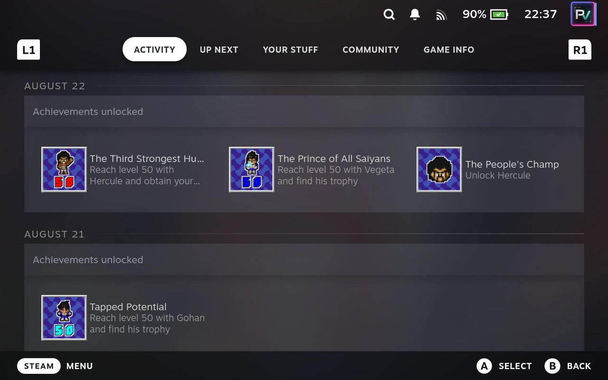</td>
    <td width="50%">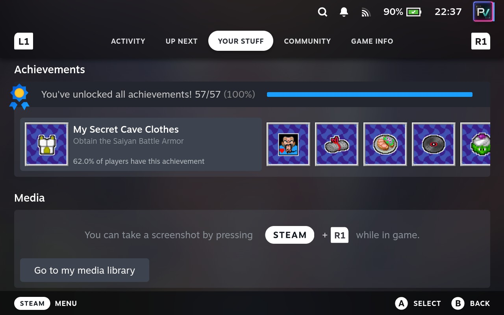</td>
  </tr>
</table>

## See it in action

### Provider profiles

<table>
  <tr>
    <th width="50%">RetroAchievements</th>
    <th width="50%">Steam</th>
  </tr>
  <tr>
    <td width="50%">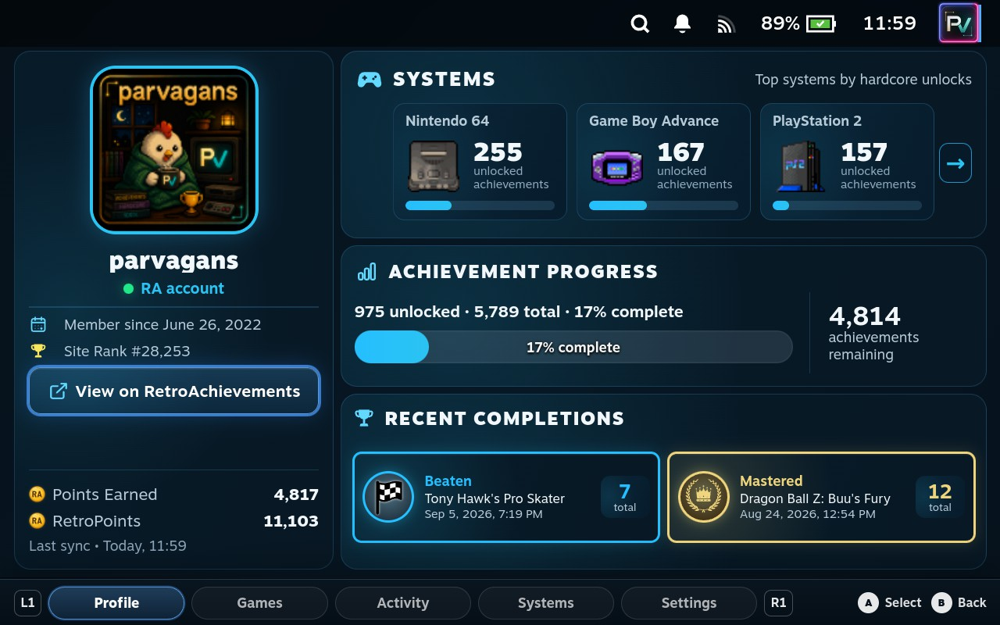</td>
    <td width="50%">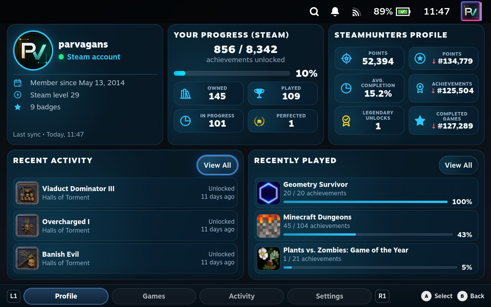</td>
  </tr>
</table>

### Games and Activity

<table>
  <tr>
    <th width="50%">RetroAchievements Games</th>
    <th width="50%">RetroAchievements Activity</th>
  </tr>
  <tr>
    <td width="50%">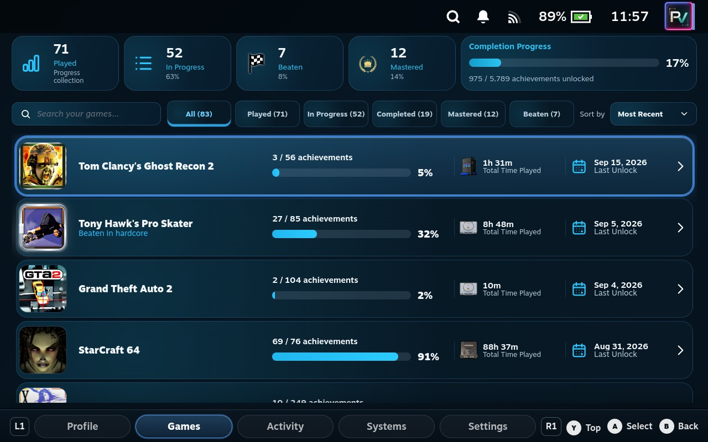</td>
    <td width="50%">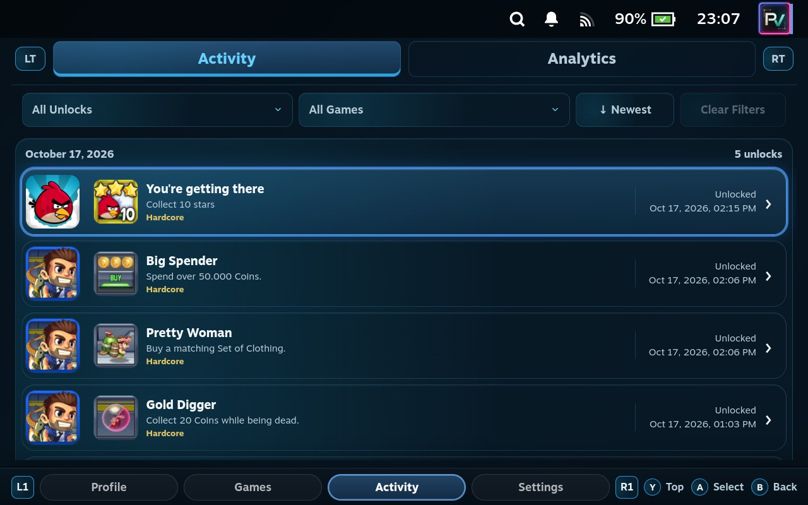</td>
  </tr>
  <tr>
    <th width="50%">Steam Games</th>
    <th width="50%">Steam Activity</th>
  </tr>
  <tr>
    <td width="50%">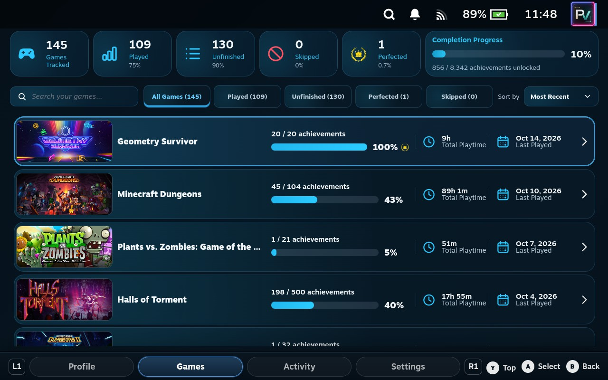</td>
    <td width="50%">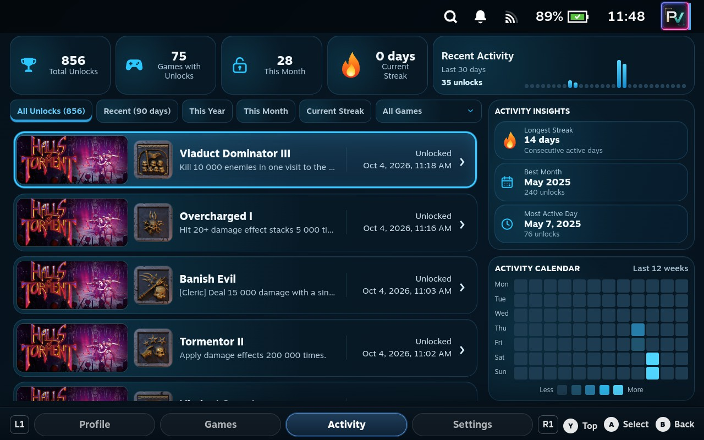</td>
  </tr>
</table>

### Full-screen game pages

Steam game pages include achievements, DLC groups, and community insights. RetroAchievements game pages keep Hardcore and Softcore progress distinct and include supported subsets.

<table>
  <tr>
    <th width="50%">Steam Overview</th>
    <th width="50%">Steam Achievements</th>
  </tr>
  <tr>
    <td width="50%">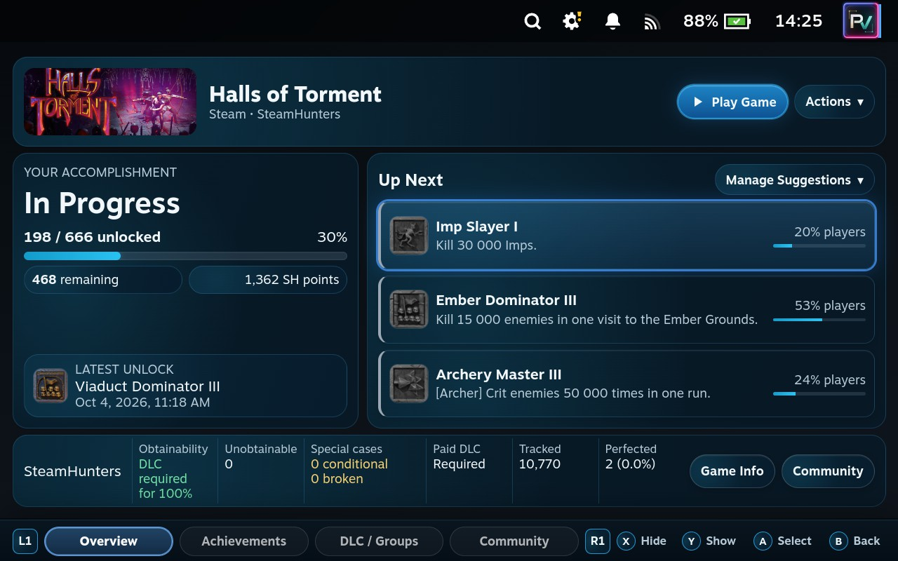</td>
    <td width="50%">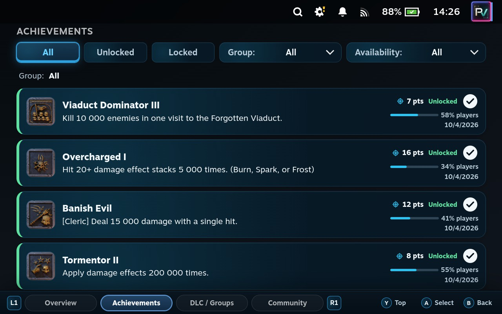</td>
  </tr>
  <tr>
    <th width="50%">Steam DLC</th>
    <th width="50%">Steam Community</th>
  </tr>
  <tr>
    <td width="50%">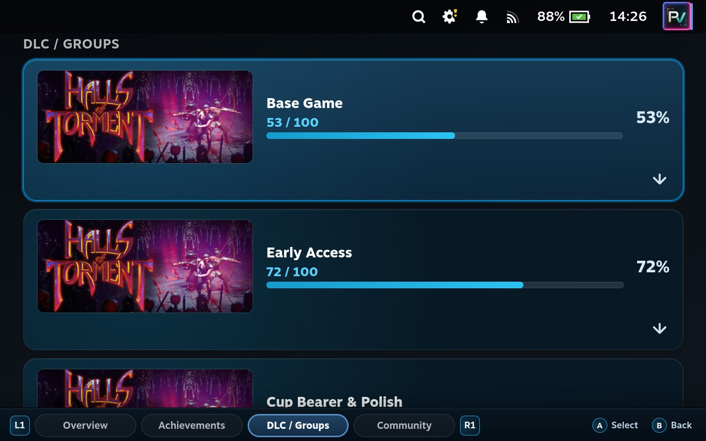</td>
    <td width="50%">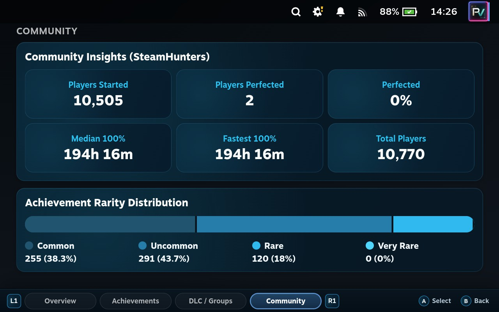</td>
  </tr>
  <tr>
    <th width="50%">RetroAchievements Overview</th>
    <th width="50%">RetroAchievements Achievements</th>
  </tr>
  <tr>
    <td width="50%">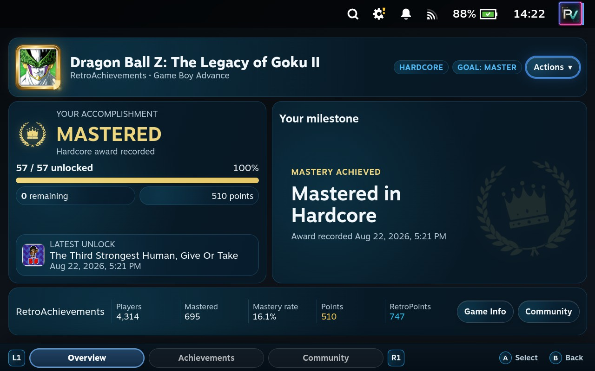</td>
    <td width="50%">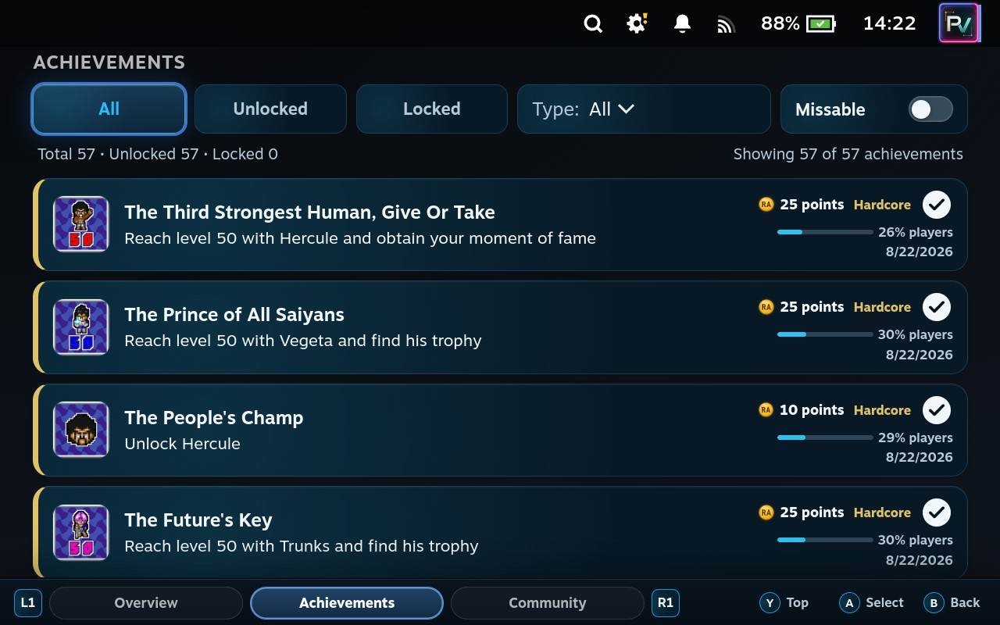</td>
  </tr>
</table>

### Native game-page status badges

The clickable badge opens the corresponding Achievement Companion detail view. It supports In Progress for both providers, Steam Perfected, and RetroAchievements Beaten or Mastered. Choose a Small, Medium, or Large layout, place it in any of six positions, or set a separate color for each status. Fresh installations use Small; settings saved before badge sizes were introduced retain the original Large layout. Default badge colors are Perfected Purple, Mastered Gold, Beaten Blue, and In Progress Gray. Unresolved non-Steam games do not receive a badge.

  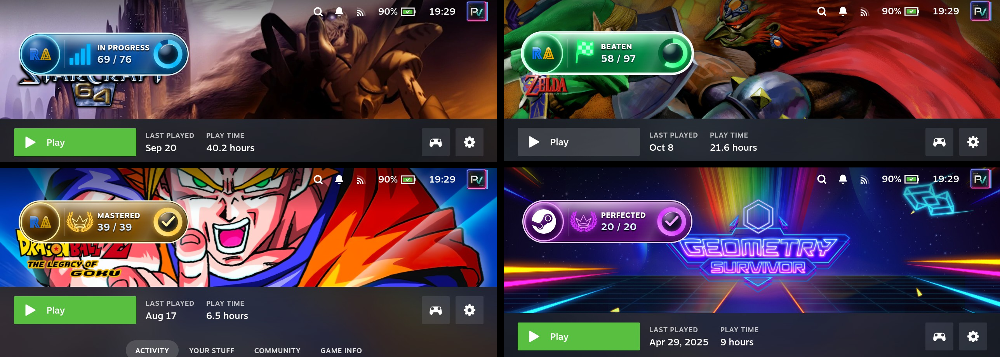

## Requirements

- Steam Deck, Steam Machine, or compatible SteamOS device running Game Mode.
- [Decky Loader](https://decky.xyz/).
- A RetroAchievements account and Web API key for RetroAchievements features.
- A Steam Web API key for Steam features. The signed-in account is detected when possible, with SteamID64 available as a fallback.

## Installation

### Decky Extended Plugins

Achievement Companion is available from [Decky Extended Plugins](https://decky-extended-plugins.beallio.com/). If that source is already configured in your Decky Loader, find Achievement Companion there and install it through Decky.

### Manual first-time installation

If Decky Extended Plugins is not configured, install Achievement Companion manually the first time:

1. Download the release ZIP from [GitHub Releases](https://github.com/parvagans/achievement-companion/releases/latest).
2. In Game Mode, open Decky Loader settings and enable **Developer Mode** under **General → Other**.
3. Open the **Developer** tab and choose **Browse for ZIP file** to select the downloaded ZIP, or choose **Install from URL** and enter the direct release ZIP URL.
4. Install the plugin, restart the Deck if needed, and open Achievement Companion from Decky.
5. Connect RetroAchievements and/or Steam from the provider setup screens.

For RetroAchievements, enter your username and the Web API key from **Settings → Authentication**. For Steam, enter a Web API key; if the signed-in account is not detected automatically, enter its SteamID64.

## Updates

After first-time installation, automatic update checks run when the previous check is at least 24 hours old and when the Deck reconnects to the internet. You can also check on demand from **Settings → About**. Downloads are verified before Decky asks you to confirm installation; updates are never installed unattended.

## Privacy

Provider requests go directly to the services used by enabled features: RetroAchievements, Steam, GitHub Releases for update checks, and SteamHunters. Achievement Companion does not require a separate project server. API keys are handled by Decky's backend rather than browser storage, and logs redact secret-like values.

SteamHunters personal profile data is optional and can be disabled under **Steam Settings → SteamHunters**. This does not disable SteamHunters community data used for game and achievement insights.

Local secret protection cannot protect against a compromised device. Rotate a key at its provider if you believe the Deck itself has been compromised.

## Development

The project uses AI tools for code generation and review, debugging, refactoring, documentation, research, and solution exploration. AI-assisted contributions are reviewed, adjusted where necessary, and tested before being incorporated. Project design, maintenance, testing, and direction remain the maintainer's responsibility.

Achievement Companion is an independent community project and is not affiliated with RetroAchievements, Decky, Valve, or Steam. It does not provide games, ROMs, or BIOS files, unlock achievements, or modify games.

## Support Achievement Companion

Contributions through Ko-fi help cover development and maintenance. Financial support is optional; starring the [GitHub project](https://github.com/parvagans/achievement-companion), sharing feedback, and reporting bugs also help.

  
   
  <a href="https://ko-fi.com/parvagans"><strong>Contribute to development on Ko-fi →</strong></a>

## License and notices

Achievement Companion is released under the [BSD-3-Clause License](LICENSE). Third-party dependency notices are in [THIRD_PARTY_NOTICES.md](THIRD_PARTY_NOTICES.md).
