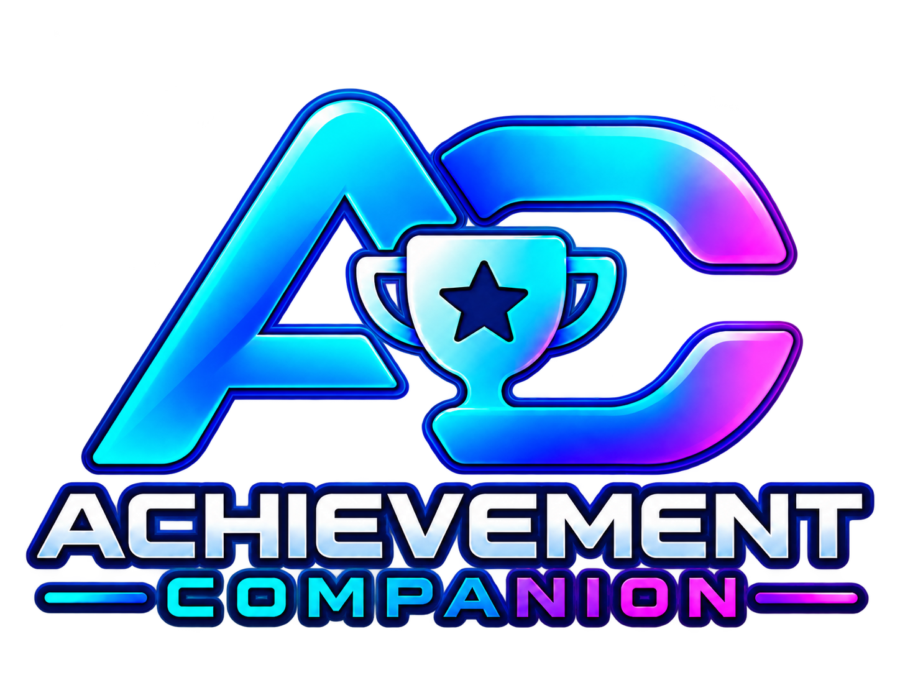
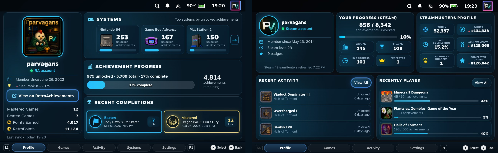
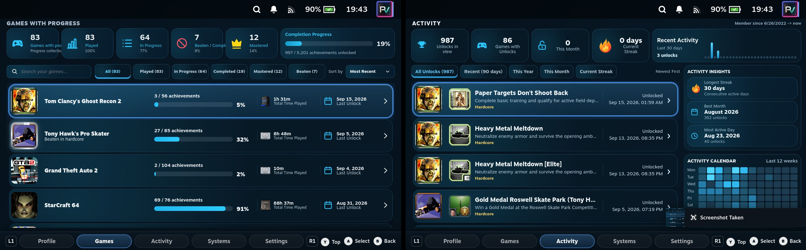
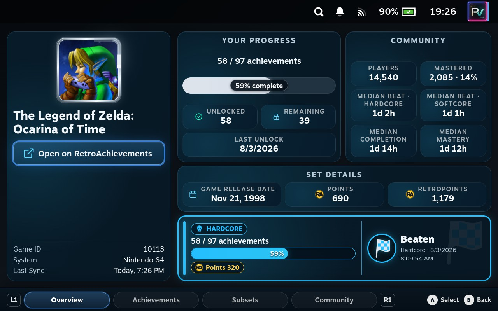

  

# Achievement Companion

**Your retro milestones. Your Steam completions. All in Game Mode.**

Achievement Companion brings RetroAchievements and Steam achievement tracking to Steam Deck and compatible SteamOS devices through Decky Loader. Check your next unlock in Quick Access, explore your collection in full-screen dashboards, and see completion badges right on your library game pages.

**RetroAchievements can appear right on Steam's library game pages** for supported non-Steam games—in Your Stuff and now in Activity.

[**Download the latest release**](https://github.com/parvagans/achievement-companion/releases/latest) · [Installation & setup](#installation) · [Report an issue](https://github.com/parvagans/achievement-companion/issues)

Optional contributions help cover development costs and support ongoing maintenance. [**Support Achievement Companion on Ko-fi →**](https://ko-fi.com/parvagans)

## Make every unlock part of the experience

From the next achievement to your next mastered game, Achievement Companion keeps the details close to where you play. The Quick Access Menu (QAM) gives you a compact view during a session; full-screen profiles and game pages give your progress room to breathe. Both are built for controller navigation.

| What you want to do | What Achievement Companion brings |
| --- | --- |
| **Bring retro achievements into your library** | RetroAchievements in Steam's native Your Stuff / Achievements and Activity tabs for supported, confidently matched non-Steam shortcuts. |
| **See how far you've come** | Full-screen RetroAchievements and Steam dashboards with profile stats, searchable game lists, completion progress, and detailed game pages. |
| **Find your next target** | Achievement details, RA subsets and classifications, plus Steam base-game, DLC, and update groups when SteamHunters data is available. |
| **Explore your achievement history** | Activity dashboards, interactive calendars, and recent unlocks that let you revisit your progress. |
| **Show off each milestone** | Clickable library game-page badges for In Progress, Steam Perfected, and RA Beaten or Mastered, with configurable colors and placement. |
| **Plan a Steam completion** | Optional SteamHunters insights into rarity, community completion times, DLC requirements, and achievement obtainability where available. |
| **Keep up with new releases** | Built-in update checks and verified downloads, with installation confirmed through Decky. |

RetroAchievements and Steam each retain their own progression rules: RA Hardcore and Softcore, Beaten and Mastered, and Steam Perfected all keep their meaning.

## RetroAchievements inside Steam

Your retro progress can live on the game's Steam library page, alongside the rest of your collection. For a non-Steam shortcut that Achievement Companion can confidently match to a RetroAchievements game:

- **Your Stuff → Achievements** shows the RA achievement list with badge artwork, descriptions, locked and unlocked states, and progress. Unlock times and global unlock rates appear when RA provides them.
- **Activity** shows your latest dated RA unlocks, newest first, with their unlock time and Hardcore or Softcore mode when known. Select a card to open that game's Achievement Companion page.

Steam ROM Manager and EmuDeck shortcuts can be matched using platform and title metadata and, where supported, ROM hashes. Unsupported or ambiguous games stay unmatched.

## See it in action

### RetroAchievements and Steam profiles

Give both sides of your collection a full-screen home, with profile statistics, recent games, and completion progress.

### RetroAchievements Games and Activity

The full-screen Games view lets you search and filter your progress. Activity brings together recent unlocks, insights, and a calendar, with the controller footer available across both views.

### RetroAchievements game detail

Explore a game's achievement set, Hardcore and Softcore progress, completion milestones, and supported subsets from one game page.

### Native game-page status badges

## RetroAchievements

Follow your collection from the first unlock to mastery:

- **Your profile at a glance:** progress, recent unlocks, Site or Casual Rank, and rank trend indicators.
- **Your next completion:** search and filter games, review unfinished, beaten, or mastered games, and open detailed game dashboards.
- **The details behind each unlock:** achievement artwork and descriptions, Missable, Progression, and Win Condition classifications, and community and set information where available.
- **More sets to explore:** discover and expand subsets from supported game pages.
- **Your preferred mode:** show Hardcore, Softcore, or both, with their progress kept distinct.
- **Your current session:** fresh RetroAchievements Rich Presence identifies current-game activity.

The full-screen **Systems** tab is a coming-soon placeholder in v0.14.1.

## Steam

Explore your Steam achievement collection beyond an individual game's percentage:

- **Profile and library dashboards:** recently played games, achievement progress, completion views, and a manual full-library scan for broader cached totals.
- **Detailed game pages:** achievement lists and individual unlock details, with base-game, DLC, and update groups when SteamHunters provides them.
- **Activity you can explore:** interactive unlock calendars, history, and insights such as streaks when enough history is available.
- **Completion context from SteamHunters:** rarity, community completion statistics and times, DLC requirements, and unobtainable or conditional achievement information where available.

SteamHunters enrichment is optional; the core Steam views work without it.

## Game-page achievement badge

See a game's achievement status before you launch it. The clickable badge appears on supported library game pages and opens the corresponding Achievement Companion detail view.

- **In Progress** is available for supported Steam or RetroAchievements games.
- **Perfected** is a Steam status; **Beaten** and **Mastered** are RetroAchievements statuses.
- The badge can be turned off, moved among six screen positions, and given a color choice for each status.

Non-Steam matching stays cautious here too. If Achievement Companion cannot safely identify the game, it does not show a badge.

## Requirements

- Steam Deck, Steam Machine, or compatible SteamOS device running Game Mode.
- [Decky Loader](https://decky.xyz/).
- A RetroAchievements account and Web API key for RA features.
- A Steam Web API key for Steam features; the signed-in Steam account is detected when possible, with SteamID64 available as a fallback.

## Installation

Until version 1.0.0, manual installation from GitHub Releases is the supported installation method. Decky Store installation is not offered.

1. Download the release ZIP from [GitHub Releases](https://github.com/parvagans/achievement-companion/releases).
2. In Game Mode, open Decky Loader settings and enable **Developer Mode** under **General → Other**.
3. Open the **Developer** tab and choose **Browse for ZIP file** to select the downloaded ZIP, or **Install from URL** and enter the direct ZIP URL.
4. Install the plugin, restart the Deck if needed, then open Achievement Companion from Decky.
5. Connect RetroAchievements and/or Steam from the provider setup screens.

This README describes the current project. Check a release's notes to see which features are included in that ZIP.

### Provider setup

For RetroAchievements, enter your username and the Web API key from RetroAchievements **Settings → Authentication**. For Steam, enter a Web API key; if the signed-in account is not detected automatically, enter its SteamID64.

## Updates

Achievement Companion can check GitHub Releases automatically (about once a day while it is running) or on demand from **Settings → About**. It verifies a downloaded update before asking Decky to confirm installation; updates are not installed unattended.

## Privacy

Provider requests go to the services needed for the features you use: RetroAchievements, Steam, GitHub Releases for update checks, and SteamHunters only when its optional enrichment is used. Achievement Companion does not require a separate project server. API keys are handled by Decky's backend instead of browser storage, and logs redact secret-like values. Local secret protection is not a defence against a compromised device, so rotate a key at its provider if you think the Deck itself is compromised.

## Help and support

If something looks wrong, [open a GitHub issue](https://github.com/parvagans/achievement-companion/issues) with the provider and page involved and enough detail to reproduce it. Never include an API key.

Achievement Companion is an independent community project, not affiliated with RetroAchievements, Decky, Valve, or Steam. It does not provide games, ROMs, or BIOS files, unlock achievements, or modify games.

## Support Achievement Companion

Help support the next update. Contributions through Ko-fi help cover **development costs and ongoing maintenance** of Achievement Companion.

[**Contribute to development on Ko-fi →**](https://ko-fi.com/parvagans)

Financial support is entirely optional. Starring the [GitHub project](https://github.com/parvagans/achievement-companion), sharing feedback, and reporting bugs also help the project grow.

## License and notices

Achievement Companion is released under the [BSD-3-Clause License](LICENSE). Third-party dependency notices are in [THIRD_PARTY_NOTICES.md](THIRD_PARTY_NOTICES.md).
