# Achievement Companion

  
  
  
  

  <strong>Your retro milestones. Your Steam completions. All in Game Mode.</strong>

  <a href="#installation"><strong>Install</strong></a>
  ·
  <a href="https://github.com/parvagans/achievement-companion/releases/latest">Latest release</a>
  ·
  <a href="#screenshots">See the plugin</a>

**Know what to unlock next without leaving Game Mode.** Achievement Companion brings RetroAchievements and Steam progress to Steam Deck and compatible SteamOS devices through Decky Loader. See your next goal in Quick Access, browse your collection with a controller, and spot progress and completion badges on library game pages.

  

## Start here

1. [Install Achievement Companion](#installation) through Decky Extended Plugins or from the latest GitHub release.
2. Open it in Game Mode and connect RetroAchievements, Steam, or both. Each provider you enable needs its own API key; see [Requirements](#requirements).
3. Check **Current Game** or **Continue Playing** in Quick Access for your next goal, or open a full-screen game page to explore your progress.

Achievement Companion is an independent community project, not affiliated with or endorsed by Valve, RetroAchievements, or Decky Loader. See [Third-Party Notices](THIRD_PARTY_NOTICES.md) for licenses and trademark information.

## Highlights

- **[Find your next unlock](#quick-access-menu):** see a focused suggestion in Quick Access or up to three recommendations on full-screen pages and matched RetroAchievements shortcuts in Steam.
- **[Stay in Game Mode](#retroachievements-inside-steam):** view RetroAchievements in Steam's Activity, Up Next, Your Stuff, Community, and Game Info sections for supported non-Steam games.
- **[Explore both collections](#screenshots):** use controller-friendly profiles, searchable games and achievements, progress views, activity calendars, and achievement details.
- **Understand Steam completions:** SteamHunters adds community rarity, completion times, DLC requirements, achievement groups, and obtainability data where available. Personal SteamHunters profile data is optional.
- **[See milestones in your library](#native-game-page-status-badges):** choose Classic or Minimal badges for In Progress, Steam Perfected, and RetroAchievements Beaten or Mastered status.
- **Make it yours:** choose from 15 themes in **Quick Access → Plugin Settings → Theme Settings**; progress and award colors keep their meaning across themes.

RetroAchievements and Steam keep their own progression rules. Choosing a RetroAchievements Beat or Master goal changes recommendations and presentation, not the recorded accomplishment.

**Explore:** [Quick Access](#quick-access-menu) · [RetroAchievements inside Steam](#retroachievements-inside-steam) · [Full-screen game pages](#full-screen-game-pages) · [Game-page badges](#native-game-page-status-badges) · [Privacy](#privacy) · [Credits](#credits-and-acknowledgements)

## Requirements

- A Steam Deck, Steam Machine, or compatible SteamOS device running Game Mode, with [Decky Loader](https://decky.xyz/) installed.
- **For RetroAchievements features:** a RetroAchievements account and Web API key.
- **For Steam features:** a Steam Web API key. Achievement Companion detects the signed-in account when possible; SteamID64 is available as a fallback.

## Installation

### Decky Extended Plugins

If [Decky Extended Plugins](https://decky-extended-plugins.beallio.com/) is already configured in Decky Loader, find Achievement Companion there and install it through Decky.

### Manual first-time installation

If Decky Extended Plugins is not configured, install Achievement Companion manually the first time:

1. Download the release ZIP from [GitHub Releases](https://github.com/parvagans/achievement-companion/releases/latest).
2. In Game Mode, open Decky Loader settings and enable **Developer Mode** under **General → Other**.
3. Open the **Developer** tab and choose **Browse for ZIP file** to select the downloaded ZIP, or choose **Install from URL** and enter the direct release ZIP URL.
4. Install the plugin, restart the Deck if needed, and open Achievement Companion from Decky.
5. Connect your chosen provider or providers from the setup screens.

For RetroAchievements, enter your username and the Web API key from **Settings → Authentication**. For Steam, enter a Web API key; if the signed-in account is not detected automatically, enter its SteamID64.

## Quick Access Menu

Quick Access shows a **Current Game** or **Continue Playing** card for each connected provider, with progress and one Up Next recommendation. Open its details, skip it, or browse the game's achievements. RetroAchievements suggestions follow the selected global or per-game Beat or Master goal; Steam prioritizes unfinished recent games with eligible achievements.

Open a game for up to three recommendations and a complete achievement browser. Search titles and descriptions, filter and sort results, or choose Detailed or Compact rows. **Actions** opens Game Info, goal and suggestion controls, and the full-screen page. After viewing achievement details, you return where you left off.

<table>
  <tr>
    <th width="50%">Beat goal</th>
    <th width="50%">Master goal</th>
  </tr>
  <tr>
    <td width="50%">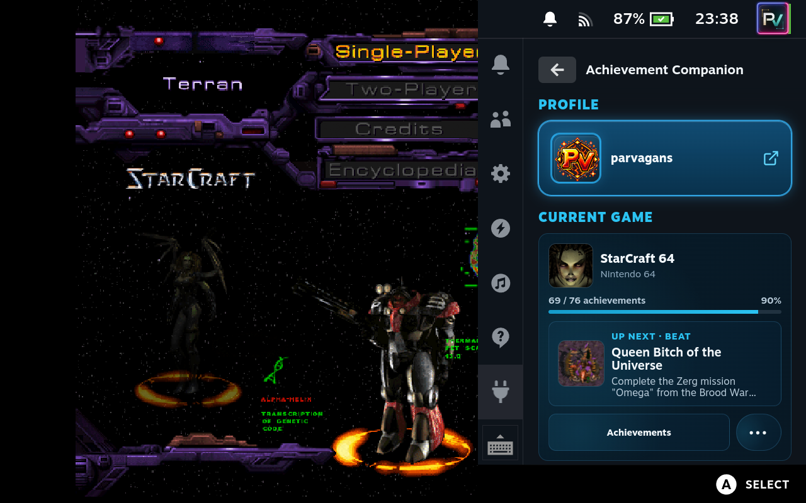</td>
    <td width="50%">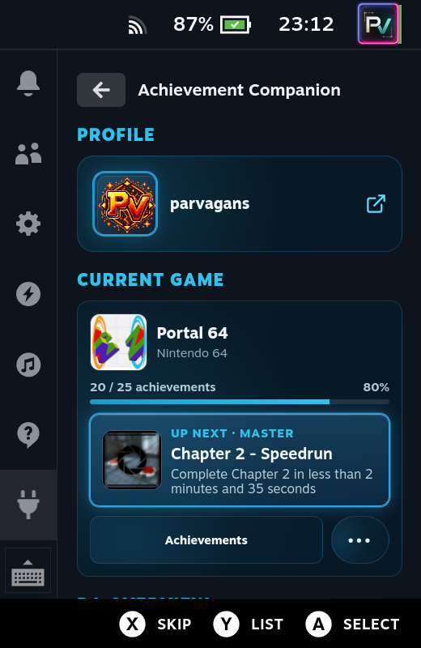</td>
  </tr>
  <tr>
    <th colspan="2">Achievement browser</th>
  </tr>
  <tr>
    <td colspan="2" align="center">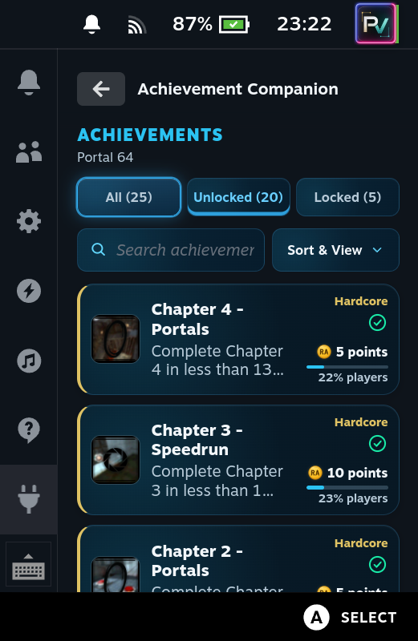</td>
  </tr>
</table>

## RetroAchievements inside Steam

For a non-Steam shortcut that Achievement Companion can confidently match to a RetroAchievements game:

- **Activity** groups dated unlocks by day in Steam's native layout. Tiles include the exact unlock time and Hardcore or Softcore mode; selecting one finds that achievement in the native Your Stuff list.
- **Up Next** shows game progress and up to three Beat or Master recommendations. Use Goal Settings to change the game's goal. Win Condition, Progression, and Missable labels identify relevant suggestions. Selecting one finds its exact row in the native achievement list; completed goals show a completion message.
- **Your Stuff → Achievements** shows badge artwork, descriptions, progress, locked and unlocked states, and unlock times or global rates when RetroAchievements provides them. Win Condition, Progression, and Missable labels also appear in the full native list.
- **Community → Playtime Stats** shows RA community milestones and sampled median times in Steam's game-page layout. Its Casual/Hardcore control is separate from your saved achievement mode: Hardcore shows Beat and Mastered statistics; Casual shows Beat and Completed statistics. **Latest Masters** shows up to ten recent mastery entries with artwork, ranks, and dates. Unavailable values are omitted, and missing profile artwork falls back to initials.
- **Game Info** adds a native metadata view with the matched game's cover, system, release date, developer, publisher, genre, and achievement availability when those fields are provided.

**ROM matching:** Steam ROM Manager and EmuDeck shortcuts are matched by accepted RetroAchievements ROM hashes, not shortcut names. Supported media include direct ROMs, ZIP archives, M3U playlists, raw disc images, PSP/PS2 CSO and ZSO, CHD CD/DVD, and GameCube/Wii RVZ, WIA, GCZ, Nintendo CISO, and WBFS. Compressed disc containers are read without extracting temporary ISO files. M3U follows RetroAchievements' first-disc identification policy; ambiguous or unrecognized revisions remain unmatched rather than being guessed from their titles.

<table>
  <tr>
    <th width="50%">Native Activity</th>
    <th width="50%">Your Stuff / Achievements</th>
  </tr>
  <tr>
    <td width="50%"></td>
    <td width="50%"></td>
  </tr>
  <tr>
    <th width="50%">Up Next / Beat goal</th>
    <th width="50%">Up Next / Master goal</th>
  </tr>
  <tr>
    <td width="50%">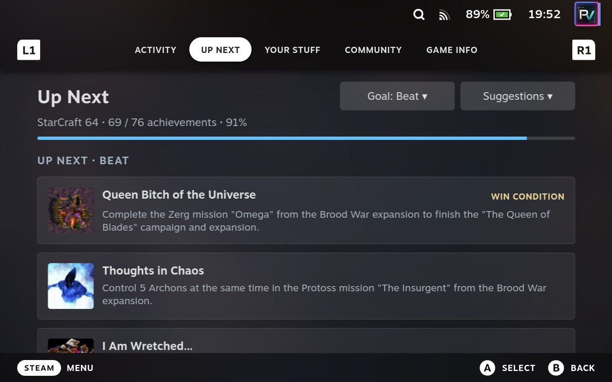</td>
    <td width="50%">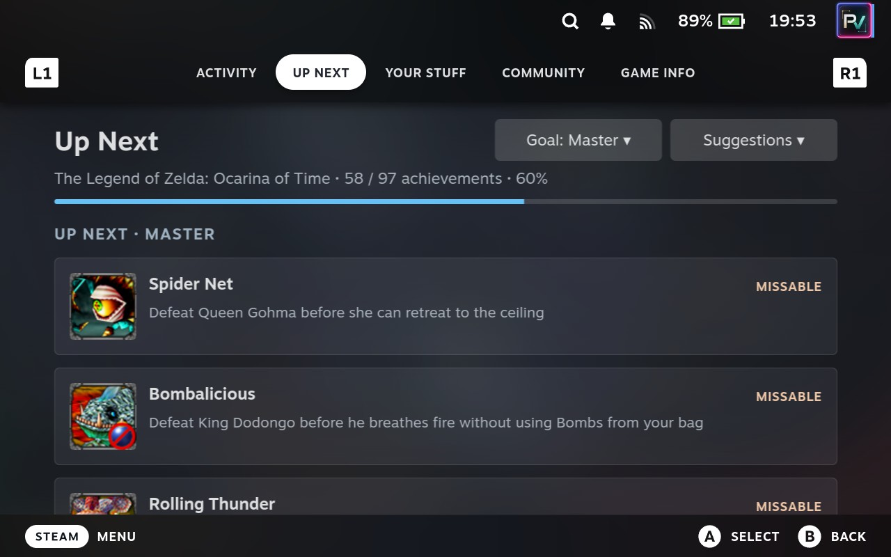</td>
  </tr>
  <tr>
    <th width="50%">Community / Playtime Stats</th>
    <th width="50%">Game Info</th>
  </tr>
  <tr>
    <td width="50%">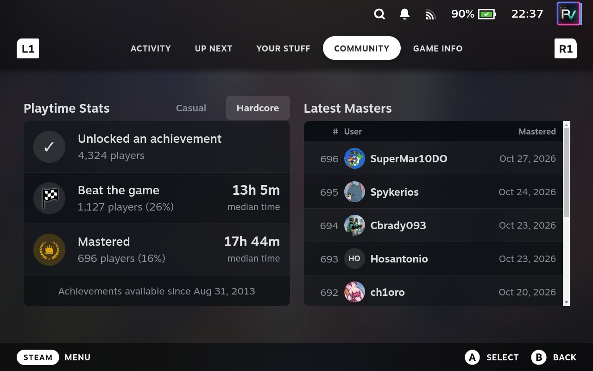</td>
    <td width="50%">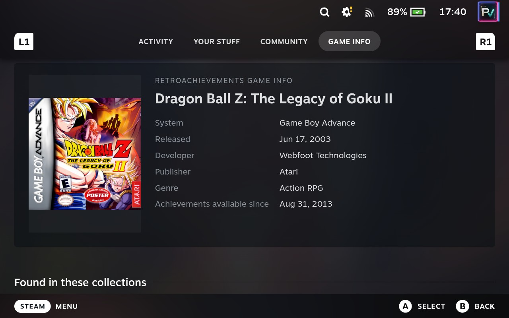</td>
  </tr>
</table>

## Screenshots

### Provider profiles

<table>
  <tr>
    <th width="50%">RetroAchievements</th>
    <th width="50%">Steam</th>
  </tr>
  <tr>
    <td width="50%"></td>
    <td width="50%"></td>
  </tr>
</table>

### Games, Activity, and Analytics

Both providers include Analytics alongside Activity; use LT/RT to switch between them. The Games view combines its existing search and filters with **Sort & View** and Detailed or Compact layouts.

<table>
  <tr>
    <th width="50%">RetroAchievements Games</th>
    <th width="50%">RetroAchievements Activity</th>
  </tr>
  <tr>
    <td width="50%"></td>
    <td width="50%"></td>
  </tr>
  <tr>
    <th width="50%">Steam Games</th>
    <th width="50%">Steam Activity</th>
  </tr>
  <tr>
    <td width="50%"></td>
    <td width="50%"></td>

  </tr>
  <tr>
    <th width="50%">RetroAchievements Analytics</th>
    <th width="50%">Steam Analytics</th>
  </tr>
  <tr>
    <td width="50%">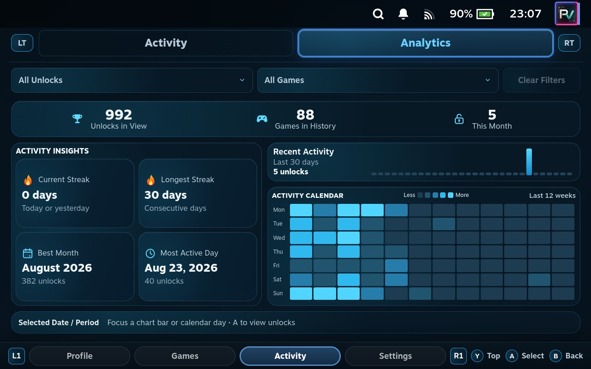</td>
    <td width="50%">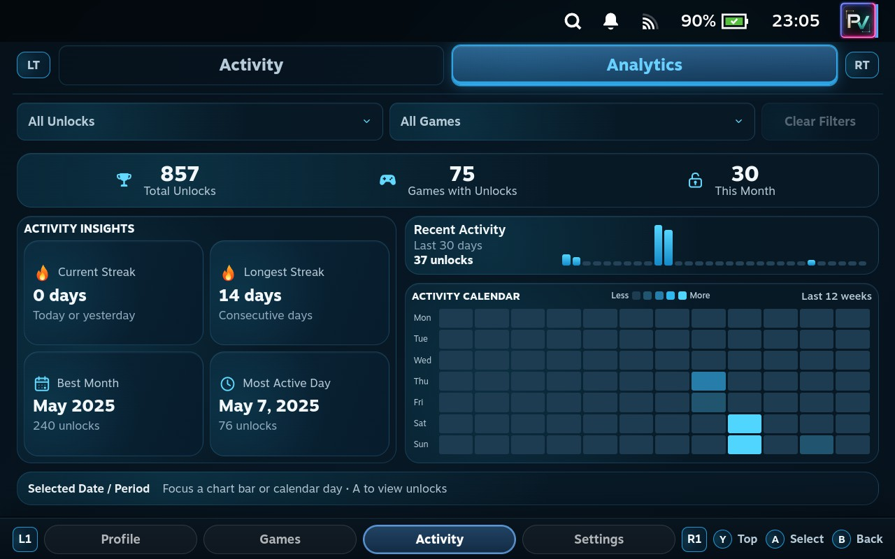</td>
  </tr>
</table>

## Full-screen game pages

The Overview puts personal progress, the latest unlock, provider metrics, and up to three Up Next recommendations on one screen. Once a goal is complete, the recommendations give way to a Beaten, Mastered, or Perfected milestone showcase.

RetroAchievements keeps Hardcore and Softcore distinct. Its Beat goal favors Progression and Win Condition achievements; Master works toward the remaining set. Steam adds SteamHunters groups, DLC and obtainability filters, and community completion insights. Returning from details or Game Info takes you back to the originating menu and focused item.

The Achievements section adds title and description search to each provider's filters. Use **Sort & View** to switch between Detailed and Compact rows; returning from details or another section restores your filters, query, sorting, display mode, focus, and scroll position.

Controls stay consistent: A selects, L1/R1 changes sections, and B follows the current menu or dialog before leaving the page. X hides a focused Up Next suggestion; Y finds it in Achievements or returns to the top of that list. Footer positions stay stable when an action is unavailable.

<table>
  <tr>
    <th width="50%">Steam Overview</th>
    <th width="50%">Steam Achievements</th>
  </tr>
  <tr>
    <td width="50%"></td>
    <td width="50%"></td>
  </tr>
  <tr>
    <th width="50%">Steam DLC / Groups</th>
    <th width="50%">SteamHunters Community</th>
  </tr>
  <tr>
    <td width="50%"></td>
    <td width="50%"></td>
  </tr>
  <tr>
    <th width="50%">RetroAchievements Goal: Beat</th>
    <th width="50%">RetroAchievements Goal: Master</th>
  </tr>
  <tr>
    <td width="50%">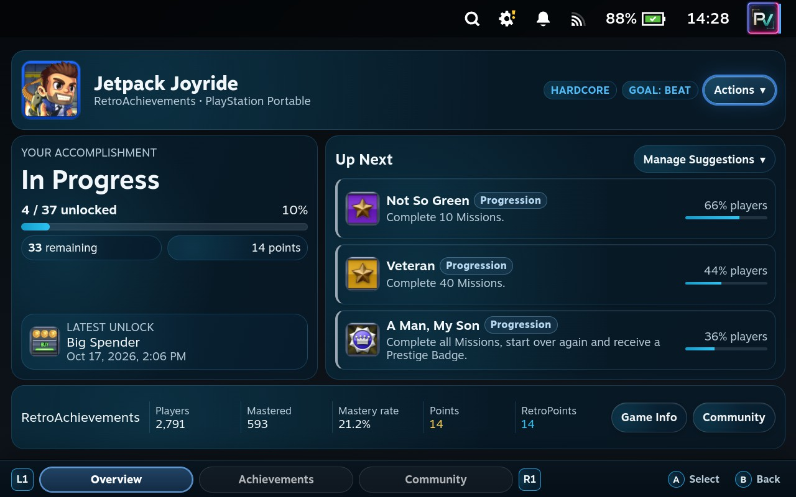</td>
    <td width="50%">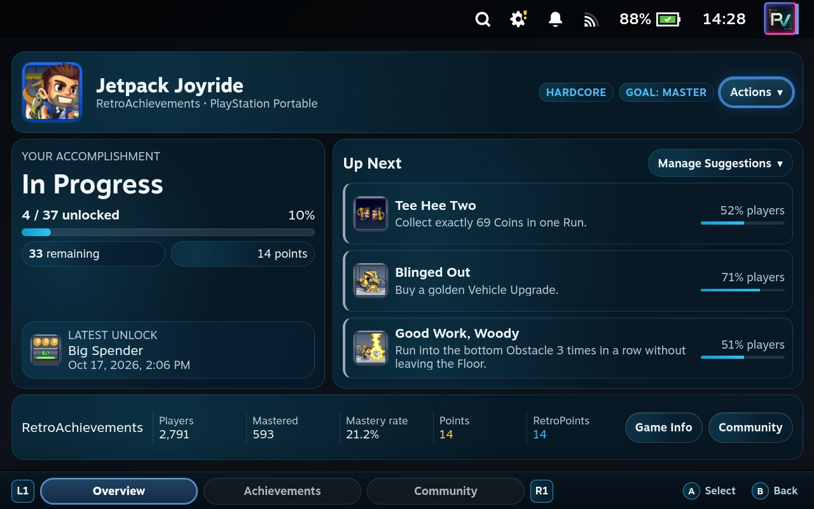</td>
  </tr>
  <tr>
    <th width="50%">RetroAchievements Mastered</th>
    <th width="50%">RetroAchievements Achievements</th>
  </tr>
  <tr>
    <td width="50%"></td>
    <td width="50%"></td>
  </tr>
  <tr>
    <th colspan="2">RetroAchievements Community</th>
  </tr>
  <tr>
    <td colspan="2" align="center">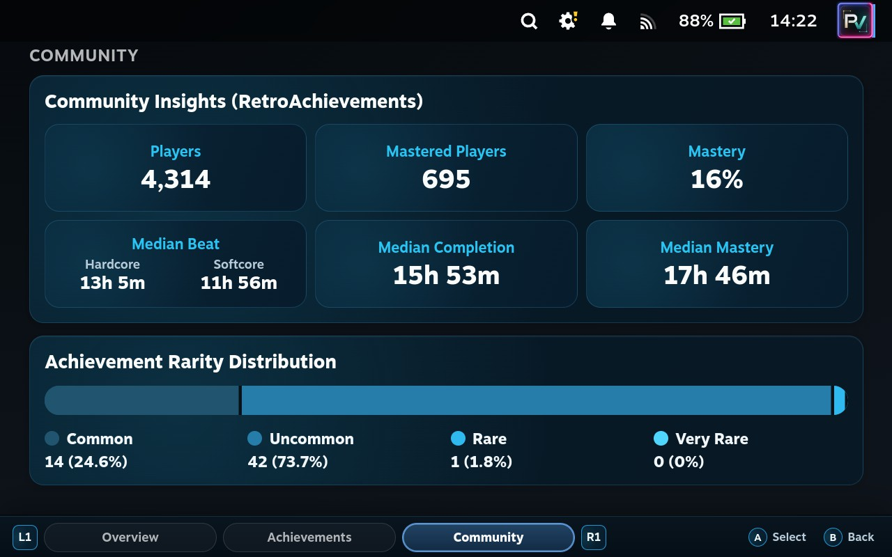</td>
  </tr>
</table>

## Native game-page status badges

Library game-page badges show In Progress for either provider, Steam Perfected, or RetroAchievements Beaten and Mastered status. Select a badge to open its Achievement Companion details. Choose the colorful **Classic** or monochrome **Minimal** style, then select Small, Medium, or Large and one of six positions. Both styles support controller focus and activation alongside Steam's normal game-page navigation.

Classic has separate colors for each status: Perfected Purple, Mastered Gold, Beaten Blue, and In Progress Gray by default. Minimal uses a charcoal surface and monochrome artwork. Switching styles keeps your Classic color choices. New installations use Classic and Small; settings saved before badge sizes were introduced retain the original Large layout. Unmatched non-Steam games do not receive a badge.

  <strong>Classic</strong> 
  

  <strong>Minimal</strong> 
  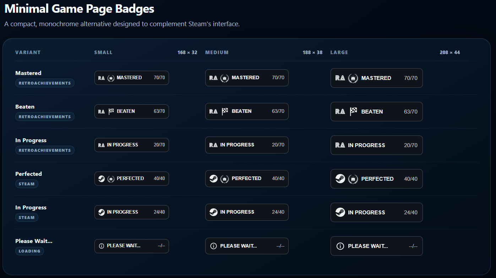

## Updates

After first-time installation, automatic update checks run when the previous check is at least 24 hours old and when the Deck reconnects to the internet. You can also check on demand from **Settings → About**. Downloads are verified before Decky asks you to confirm installation; updates are never installed unattended.

## Privacy

Provider requests go directly to the services used by enabled features: RetroAchievements, Steam, GitHub Releases for update checks, and SteamHunters. Achievement Companion does not require a separate project server. API keys are handled by Decky's backend rather than browser storage, and logs redact secret-like values.

SteamHunters personal profile data is optional and can be disabled under **Steam Settings → SteamHunters**. This does not disable SteamHunters community data used for game and achievement insights.

If a personal SteamHunters profile is unavailable, Achievement Companion uses meaningful Steam library data where possible and otherwise hides that section.

Local secret protection cannot protect against a compromised device. Rotate a key at its provider if you believe the Deck itself has been compromised.

## About the project

The maintainer uses AI tools for code generation and review, debugging, refactoring, documentation, and research. AI-assisted contributions are reviewed, adjusted where needed, and tested before being incorporated. Project design, maintenance, testing, and direction remain the maintainer's responsibility.

Achievement Companion does not provide games, ROMs, or BIOS files, unlock achievements, or modify games.

## Support Achievement Companion

If Achievement Companion is useful, star the [GitHub project](https://github.com/parvagans/achievement-companion), share feedback, or [open an issue](https://github.com/parvagans/achievement-companion/issues) to report a bug or suggest an improvement. Never include an API key in a public issue. If you would like to contribute financially, Ko-fi support helps cover ongoing development and maintenance.

For private questions or matters that do not belong in the public issue tracker, contact [achievement-companion@proton.me](mailto:achievement-companion@proton.me). Never send provider API keys or other secrets by email.

  
  

## Credits and acknowledgements

Achievement Companion builds on and integrates with the work of these projects and services:

- [Decky Loader](https://decky.xyz/) and the [`@decky/ui` toolkit](https://github.com/SteamDeckHomebrew/decky-frontend-lib) provide the plugin host and native Game Mode controls.
- [RetroAchievements](https://retroachievements.org/) provides retro achievement data, while [rcheevos](https://github.com/RetroAchievements/rcheevos) supplies the console-specific hashing used to identify compatible ROMs.
- [nod](https://github.com/encounter/nod) reads Nintendo disc containers, [libchdr](https://github.com/rtissera/libchdr) handles CHD media, and [LZ4](https://github.com/lz4/lz4) handles ZSO decompression. Exact versions and licenses are documented in [Third-Party Notices](THIRD_PARTY_NOTICES.md).
- [Steam](https://store.steampowered.com/) and the [Steam Web API](https://steamcommunity.com/dev) provide Steam identity, library, playtime, and achievement data.
- [SteamHunters](https://steamhunters.com/) provides optional community and personal completion insights.
- [Decky Extended Plugins](https://decky-extended-plugins.beallio.com/) provides a community distribution channel for Achievement Companion.
- GitHub and Ko-fi support actions use their official brand assets; the Steam provider uses an icon from [Streamline](https://streamlinehq.com/).

For complete dependency licenses, bundled native-code notices, and trademark information, see [Third-Party Notices](THIRD_PARTY_NOTICES.md).

## License and notices

Achievement Companion is released under the [BSD-3-Clause License](LICENSE). Third-party dependency notices are in [THIRD_PARTY_NOTICES.md](THIRD_PARTY_NOTICES.md).
