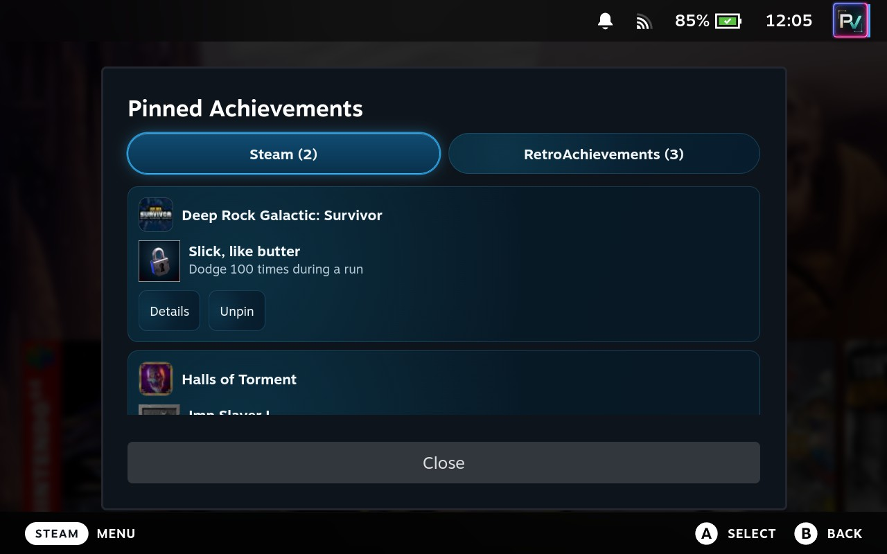
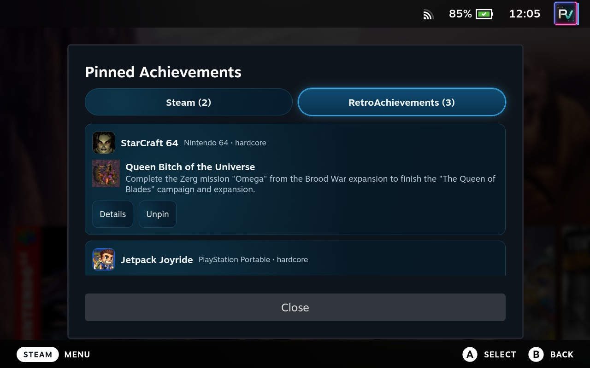
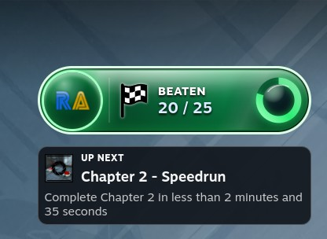
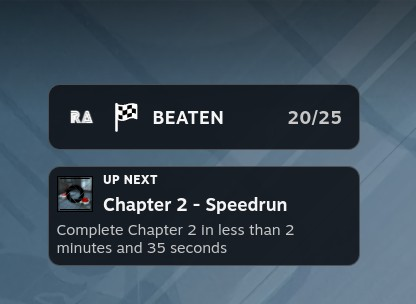

# Achievement Companion

  
  
  
  

  <strong>Your retro milestones. Your Steam completions. All in Game Mode.</strong>

  <a href="#installation"><strong>Install</strong></a>
  ·
  <a href="https://github.com/parvagans/achievement-companion/releases/latest">Latest release</a>
  ·
  <a href="#screenshots">See the plugin</a>

**Know what to unlock next without leaving Game Mode.** Achievement Companion brings RetroAchievements and Steam progress to Steam Deck and compatible SteamOS devices through Decky Loader. See your next goal in Quick Access, browse your collection with a controller, and spot progress and completion badges on library game pages.

  

## Start here

1. [Install Achievement Companion](#installation) through Decky Extended Plugins or from the latest GitHub release.
2. Open it in Game Mode and connect RetroAchievements, Steam, or both. Each provider you enable needs its own API key; see [Requirements](#requirements).
3. Check **Current Game** or **Continue Playing** in Quick Access for your next goal, or open a full-screen game page to explore your progress.

Achievement Companion is an independent community project, not affiliated with or endorsed by Valve, RetroAchievements, or Decky Loader. See [Third-Party Notices](THIRD_PARTY_NOTICES.md) for licenses and trademark information.

## Highlights

- **[Choose your next unlock](#quick-access-menu):** pin a Steam or RetroAchievements target, manage saved targets from the Quick Access header, or follow automatic suggestions in full-screen Overview and supported native Steam views.
- **[Stay in Game Mode](#retroachievements-inside-steam):** view RetroAchievements in Steam's Activity, Up Next, Your Stuff, Community, and Game Info sections for supported non-Steam games.
- **[Explore both collections](#screenshots):** use controller-friendly profiles, searchable games and achievements, progress views, activity calendars, and achievement details.
- **Understand Steam completions:** SteamHunters adds community rarity, completion times, DLC requirements, achievement groups, and obtainability data where available. Personal SteamHunters profile data is optional.
- **[See progress and your next target in your library](#native-game-page-status-badges):** choose Classic or Minimal status badges and an optional Up Next preview on native game pages.
- **Make it yours:** choose from 15 themes in **Quick Access → Plugin Settings → Theme Settings**; progress and award colors keep their meaning across themes.

RetroAchievements and Steam keep their own progression rules. Choosing a RetroAchievements Beat or Master goal changes recommendations and presentation, not the recorded accomplishment.

**Explore:** [Data synchronization](#retroachievements-data-synchronization) · [Quick Access](#quick-access-menu) · [Pinned achievements](#pinned-achievements) · [RetroAchievements inside Steam](#retroachievements-inside-steam) · [Full-screen game pages](#full-screen-game-pages) · [Game-page badges](#native-game-page-status-badges) · [Privacy](#privacy) · [Credits](#credits-and-acknowledgements)

## Requirements

- A Steam Deck, Steam Machine, or compatible SteamOS device running Game Mode, with [Decky Loader](https://decky.xyz/) installed.
- **For RetroAchievements features:** a RetroAchievements account and Web API key.
- **For Steam features:** a Steam Web API key. Achievement Companion detects the signed-in account when possible; SteamID64 is available as a fallback.

## Installation

### Decky Extended Plugins

If [Decky Extended Plugins](https://decky-extended-plugins.beallio.com/) is already configured in Decky Loader, find Achievement Companion there and install it through Decky.

### Manual first-time installation

If Decky Extended Plugins is not configured, install Achievement Companion manually the first time:

1. Download the release ZIP from [GitHub Releases](https://github.com/parvagans/achievement-companion/releases/latest).
2. In Game Mode, open Decky Loader settings and enable **Developer Mode** under **General → Other**.
3. Open the **Developer** tab and choose **Browse for ZIP file** to select the downloaded ZIP, or choose **Install from URL** and enter the direct release ZIP URL.
4. Install the plugin, restart the Deck if needed, and open Achievement Companion from Decky.
5. Connect your chosen provider or providers from the setup screens.

For RetroAchievements, enter your username and the Web API key from **Settings → Authentication**. For Steam, enter a Web API key; if the signed-in account is not detected automatically, enter its SteamID64.

## Quick Access Menu

The game comes first, with compact shortcuts beside the heading: the **header thumbtack** opens Pinned Achievements, and your **avatar** opens your full-screen profile. Both shortcuts remain available when there is no game to recommend.

### Up Next

Quick Access shows a **Current Game** or **Continue Playing** card for each connected provider, with progress and one Up Next recommendation. Open its details, skip it, or browse the game's achievements. Larger game titles and descriptions beneath the achievement artwork/title row keep the recommendation readable. Automatic RetroAchievements suggestions follow the selected global or per-game Beat or Master goal; Steam prioritizes unfinished recent games with eligible achievements.

Use the **thumbtack in the game card’s action row** to pin or unpin the current recommendation. A filled thumbtack marks your manual target, which takes priority over automatic suggestions without changing your Beat/Master goal. Pins are saved separately for each account and game and shared across Quick Access, full-screen Overview, and supported native Steam views. Removing or completing a pin restores automatic selection; RetroAchievements pins respect the completion mode selected when pinned. **Set as Up Next** and **Remove from Up Next** also remain available in the existing suggestion and achievement-detail menus.

Open a game for up to three recommendations and a complete achievement browser. Search titles and descriptions, filter and sort results, or choose Detailed or Compact rows. **Actions** opens Game Info, goal and suggestion controls, and the full-screen page. After viewing achievement details, you return where you left off.

<table>
  <tr>
    <th width="50%">Beat goal</th>
    <th width="50%">Master goal</th>
  </tr>
  <tr>
    <td width="50%"></td>
    <td width="50%"></td>
  </tr>
  <tr>
    <th colspan="2">Achievement browser</th>
  </tr>
  <tr>
    <td colspan="2" align="center"></td>
  </tr>
</table>

### Pinned Achievements

Open the **header thumbtack** to view saved targets across your configured Steam and RetroAchievements accounts. When both providers are connected, switch tabs to see each provider’s pins and counts. Each entry shows its game, achievement, description when available, and RetroAchievements completion mode where relevant.

Choose **Details** to inspect an achievement or **Unpin** to remove the saved target. From Details, **View Game** opens the compact game overview; **B** from that game returns to the pinned viewer at the originating entry. **Close** or **B** in the viewer returns to its header shortcut. Unpinning updates the other supported views too.

The header thumbtack opens this viewer; the thumbtack inside the Up Next action row continues to pin or unpin the current recommendation.

<table>
  <tr>
    <th width="50%">Steam pinned achievements</th>
    <th width="50%">RetroAchievements pinned achievements</th>
  </tr>
  <tr>
    <td width="50%"></td>
    <td width="50%"></td>
  </tr>
</table>

### Activity Calendar

Steam and RetroAchievements Activity Calendars **start collapsed**. Select the calendar heading and press **A** to expand or collapse it; the heading shows the configured week range. Each provider remembers its expanded/collapsed preference separately between sessions and restarts.

Expand the calendar to select a date and filter Recent Activity and the associated games. Collapsing keeps that filter active: the heading shows the selected date, and **Clear date filter** removes it without reopening the calendar. **B** exits calendar day navigation as before.

## RetroAchievements inside Steam

For a non-Steam shortcut that Achievement Companion can confidently match to a RetroAchievements game:

- **Activity** groups dated unlocks by day in Steam's native layout. Tiles include the exact unlock time and Hardcore or Softcore mode; selecting one finds that achievement in the native Your Stuff list.
- **Up Next** shows game progress and up to three recommendations, with your pinned target first. Press **Y Pin/Unpin** on a focused card to choose or remove a manual target; the native footer shows the action and a filled thumbtack marks the pinned achievement. **X Skip** hides a suggestion, and selecting a card finds it in the native achievement list. Change Beat/Master goals in Goal Settings or restore hidden suggestions individually or all at once in Suggestions. Pins and hidden choices sync with QAM and full-screen. Win Condition, Progression, and Missable labels clarify recommendations; completed goals show a completion message unless an unfinished manual pin remains active.
- **Your Stuff → Achievements** shows badge artwork, descriptions, progress, locked and unlocked states, and unlock times or global rates when RetroAchievements provides them. Win Condition, Progression, and Missable labels also appear in the full native list.
- **Community → Playtime Stats** shows RA community milestones and sampled median times in Steam's game-page layout. Its Casual/Hardcore control is separate from your saved achievement mode: Hardcore shows Beat and Mastered statistics; Casual shows Beat and Completed statistics. **Latest Masters** shows up to ten recent mastery entries with artwork, ranks, and dates. Unavailable values are omitted, and missing profile artwork falls back to initials.
- **Game Info** adds a native metadata view with the matched game's cover, system, release date, developer, publisher, genre, and achievement availability when those fields are provided.

**ROM matching:** Steam ROM Manager and EmuDeck shortcuts are matched by accepted RetroAchievements ROM hashes, not shortcut names. Supported media include direct ROMs, ZIP archives, M3U playlists, raw disc images, PSP/PS2 CSO and ZSO, CHD CD/DVD, and GameCube/Wii RVZ, WIA, GCZ, Nintendo CISO, and WBFS. Compressed disc containers are read without extracting temporary ISO files. M3U follows RetroAchievements' first-disc identification policy; ambiguous or unrecognized revisions remain unmatched rather than being guessed from their titles.

<table>
  <tr>
    <th width="50%">Native Activity</th>
    <th width="50%">Your Stuff / Achievements</th>
  </tr>
  <tr>
    <td width="50%"></td>
    <td width="50%"></td>
  </tr>
  <tr>
    <th width="50%">Up Next / Beat goal</th>
    <th width="50%">Up Next / Master goal</th>
  </tr>
  <tr>
    <td width="50%"></td>
    <td width="50%"></td>
  </tr>
  <tr>
    <th width="50%">Community / Playtime Stats</th>
    <th width="50%">Game Info</th>
  </tr>
  <tr>
    <td width="50%"></td>
    <td width="50%"></td>
  </tr>
</table>

## Screenshots

### Provider profiles

<table>
  <tr>
    <th width="50%">RetroAchievements</th>
    <th width="50%">Steam</th>
  </tr>
  <tr>
    <td width="50%"></td>
    <td width="50%"></td>
  </tr>
</table>

### Games, Activity, and Analytics

Both providers include Analytics alongside Activity; use LT/RT to switch between them. The Games view combines its existing search and filters with **Sort & View** and Detailed or Compact layouts.

<table>
  <tr>
    <th width="50%">RetroAchievements Games</th>
    <th width="50%">RetroAchievements Activity</th>
  </tr>
  <tr>
    <td width="50%"></td>
    <td width="50%"></td>
  </tr>
  <tr>
    <th width="50%">Steam Games</th>
    <th width="50%">Steam Activity</th>
  </tr>
  <tr>
    <td width="50%"></td>
    <td width="50%"></td>

  </tr>
  <tr>
    <th width="50%">RetroAchievements Analytics</th>
    <th width="50%">Steam Analytics</th>
  </tr>
  <tr>
    <td width="50%"></td>
    <td width="50%"></td>
  </tr>
</table>

## Full-screen game pages

The Overview puts personal progress, the latest unlock, provider metrics, and up to three Up Next recommendations on one screen. The three achievement cards share equal height and consistent spacing; descriptions use two-line summaries, with complete text available in achievement details. Without an active manual pin, a completed goal replaces recommendations with a Beaten, Mastered, or Perfected milestone showcase.

Pin or unpin a recommendation with its adjacent **thumbtack**. The filled icon identifies the active manual target without repeating pinned or goal labels inside the card. Your target stays shared with Quick Access and supported native Steam views, and choosing one preserves the game's Beat/Master goal.

RetroAchievements keeps Hardcore and Softcore distinct. Its Beat goal favors Progression and Win Condition achievements; Master works toward the remaining set. Steam adds SteamHunters groups, DLC and obtainability filters, and community completion insights. Returning from details or Game Info takes you back to the originating menu and focused item.

The Achievements section adds title and description search to each provider's filters. Use **Sort & View** to switch between Detailed and Compact rows; returning from details or another section restores your filters, query, sorting, display mode, focus, and scroll position.

Eligible RetroAchievements games offer Community before optional statistics load. Missing provider medians remain omitted; the page does not invent values to fill its layout. Subsets appears only when at least one parent-child relationship has been verified, and saved discovery checkpoints allow unfinished verification to continue.

Controls stay consistent: A selects, L1/R1 changes sections, and B follows the current menu or dialog before leaving the page. Move Right from an Up Next achievement to its thumbtack and Left to return; A on the thumbtack pins or unpins without leaving Overview. X hides a focused Up Next suggestion; Y finds it in Achievements or returns to the top of that list. Footer positions stay stable when an action is unavailable.

<table>
  <tr>
    <th width="50%">Steam Overview</th>
    <th width="50%">Steam Achievements</th>
  </tr>
  <tr>
    <td width="50%"></td>
    <td width="50%"></td>
  </tr>
  <tr>
    <th width="50%">Steam DLC / Groups</th>
    <th width="50%">SteamHunters Community</th>
  </tr>
  <tr>
    <td width="50%"></td>
    <td width="50%"></td>
  </tr>
  <tr>
    <th width="50%">RetroAchievements Goal: Beat</th>
    <th width="50%">RetroAchievements Goal: Master</th>
  </tr>
  <tr>
    <td width="50%"></td>
    <td width="50%"></td>
  </tr>
  <tr>
    <th width="50%">RetroAchievements Mastered</th>
    <th width="50%">RetroAchievements Achievements</th>
  </tr>
  <tr>
    <td width="50%"></td>
    <td width="50%"></td>
  </tr>
  <tr>
    <th colspan="2">RetroAchievements Community</th>
  </tr>
  <tr>
    <td colspan="2" align="center"></td>
  </tr>
</table>

## Native game-page status badges

Library game-page badges show In Progress for either provider, Steam Perfected, or RetroAchievements Beaten and Mastered status. Select a badge to open its Achievement Companion details. Choose the colorful **Classic** or monochrome **Minimal** style, then select Small, Medium, or Large and one of six positions. Both styles support controller focus and activation alongside Steam's normal game-page navigation.

Classic has separate colors for each status: Perfected Purple, Mastered Gold, Beaten Blue, and In Progress Gray by default. Minimal uses a charcoal surface and monochrome artwork. Switching styles keeps your Classic color choices. New installations use Classic and Small; settings saved before badge sizes were introduced retain the original Large layout. Unmatched non-Steam games do not receive a badge.

  <strong>Classic</strong> 
  

  <strong>Minimal</strong> 
  

### Up Next preview

Show your current Steam or matched RetroAchievements target beside the native badge. The preview follows the badge's position and width, uses a neutral Minimal-style surface with either badge style, and includes achievement artwork, a title, and a small thumbtack for a manual pin. Selecting the badge still opens the matching Achievement Companion game page.

In **Badge appearance**, set **Up Next Preview** to **On Focus** (the default), **Always Show**, or **Hidden**. On Focus shows the preview while the badge has controller focus or mouse hover; Always Show keeps it with the native game page; Hidden leaves the badge available without a preview.

The separate **Achievement Description** setting uses the same three options and also defaults to **On Focus**. Show the available description on focus, whenever the preview is visible, or never. This controls only the description: a Hidden preview stays hidden regardless of the description setting. If a complete description cannot fit safely, the preview falls back to its compact title/artwork presentation; full text remains available in achievement details.

<table>
  <tr>
    <th width="50%">Classic badge with Up Next</th>
    <th width="50%">Minimal badge with Up Next</th>
  </tr>
  <tr>
    <td width="50%"></td>
    <td width="50%"></td>
  </tr>
</table>

## RetroAchievements data synchronization

Quick Access, full-screen pages, matched Steam badges, and native Steam integrations share canonical RetroAchievements resources. The Decky backend persists validated responses in a local SQLite cache and applies resource-specific freshness policies. Concurrent consumers share requests through one scheduler, which paces dispatch, bounds retries, and honors provider cooldowns, including manual Retry. Freshness windows are application policy, not a claim about RetroAchievements API quotas.

- **Targeted refreshes:** profile data, game progress, Community statistics, catalogues, and Rich Presence have independent lifetimes. Opening a game does not fetch Community statistics just to decide whether its tab exists, and profile entry does not import lifetime achievement history.
- **Current Game and Continue Playing:** Rich Presence uses a separate 45-second freshness window, launch/exit notifications, and bounded visible-session checks. Current shortcut identity and corroborated session evidence govern local exit handling; later ROM transitions take precedence over initial launch mapping. Recently observed sessions remain Continue Playing candidates until authoritative recent-play records catch up. RetroAchievements does not identify the originating device, so presence is account activity rather than a guaranteed local-device signal.
- **Consistent presentations:** derived pages retain the canonical revisions used to build them. Re-entry rebuilds obsolete presentations from fresh local resources; open achievement lists remain stable. Targeted presence and Community updates reach mounted consumers without replacing the whole profile or resetting navigation.
- **Durable history and subsets:** achievement-history imports are bounded, resumable, and incremental, with distinct Hardcore/Softcore events and atomic checkpoints. Subset discovery persists verification checkpoints, retains established relationships through incomplete responses, and exposes Subsets only when verified children exist.
- **Loading and recovery:** required revalidation uses the branded loading presentation with a bounded foreground wait. Valid cached content remains usable after provider failures. Community keeps a native focus anchor across loading and ready states, and displays only statistics supported by available provider evidence.
- **Account and operation ownership:** account-scoped identities, exact content provenance, publication ownership, and durable invalidation fences prevent obsolete responses or delayed database reads from replacing newer canonical data. Cancelled consumers do not abandon authorized durability work; graceful shutdown drains owned invalidations.

The local cache survives plugin restarts. Profile, recent-play, progress, and history data remain revalidatable: resets, set revisions, and later provider activity can change them. Sync diagnostics expose storage health, request activity, cooldowns, and targeted recovery without requiring a cache wipe. See [RetroAchievements data reliability](docs/retroachievements-data-reliability.md) for resource policies, limits, and implementation details.

## Updates

After first-time installation, automatic update checks run when the previous check is at least 24 hours old and when the Deck reconnects to the internet. You can also check on demand from **Settings → About**. Downloads are verified before Decky asks you to confirm installation; updates are never installed unattended.

## Privacy

Provider requests go directly to the services used by enabled features: RetroAchievements, Steam, GitHub Releases for update checks, and SteamHunters. Achievement Companion does not require a separate project server. API keys are handled by Decky's backend rather than browser storage, and logs redact secret-like values. Validated RetroAchievements responses, achievement history, and synchronization checkpoints are stored locally; account resources are isolated by credential scope, and cache identities do not contain API keys.

SteamHunters personal profile data is optional and can be disabled under **Steam Settings → SteamHunters**. This does not disable SteamHunters community data used for game and achievement insights.

If a personal SteamHunters profile is unavailable, Achievement Companion uses meaningful Steam library data where possible and otherwise hides that section.

Local secret protection cannot protect against a compromised device. Rotate a key at its provider if you believe the Deck itself has been compromised.

## About the project

The maintainer uses AI tools for code generation and review, debugging, refactoring, documentation, and research. AI-assisted contributions are reviewed, adjusted where needed, and tested before being incorporated. Project design, maintenance, testing, and direction remain the maintainer's responsibility.

Achievement Companion does not provide games, ROMs, or BIOS files, unlock achievements, or modify games.

## Support Achievement Companion

If Achievement Companion is useful, star the [GitHub project](https://github.com/parvagans/achievement-companion), share feedback, or [open an issue](https://github.com/parvagans/achievement-companion/issues) to report a bug or suggest an improvement. Never include an API key in a public issue. If you would like to contribute financially, Ko-fi support helps cover ongoing development and maintenance.

For private questions or matters that do not belong in the public issue tracker, contact [achievement-companion@proton.me](mailto:achievement-companion@proton.me). Never send provider API keys or other secrets by email.

  
  

## Credits and acknowledgements

Achievement Companion builds on and integrates with the work of these projects and services:

- [Decky Loader](https://decky.xyz/) and the [`@decky/ui` toolkit](https://github.com/SteamDeckHomebrew/decky-frontend-lib) provide the plugin host and native Game Mode controls.
- [RetroAchievements](https://retroachievements.org/) provides retro achievement data, while [rcheevos](https://github.com/RetroAchievements/rcheevos) supplies the console-specific hashing used to identify compatible ROMs.
- [nod](https://github.com/encounter/nod) reads Nintendo disc containers, [libchdr](https://github.com/rtissera/libchdr) handles CHD media, and [LZ4](https://github.com/lz4/lz4) handles ZSO decompression. Exact versions and licenses are documented in [Third-Party Notices](THIRD_PARTY_NOTICES.md).
- [Steam](https://store.steampowered.com/) and the [Steam Web API](https://steamcommunity.com/dev) provide Steam identity, library, playtime, and achievement data.
- [SteamHunters](https://steamhunters.com/) provides optional community and personal completion insights.
- [Decky Extended Plugins](https://decky-extended-plugins.beallio.com/) provides a community distribution channel for Achievement Companion.
- GitHub and Ko-fi support actions use their official brand assets; the Steam provider uses an icon from [Streamline](https://streamlinehq.com/).

For complete dependency licenses, bundled native-code notices, and trademark information, see [Third-Party Notices](THIRD_PARTY_NOTICES.md).

## License and notices

Achievement Companion is released under the [BSD-3-Clause License](LICENSE). Third-party dependency notices are in [THIRD_PARTY_NOTICES.md](THIRD_PARTY_NOTICES.md).
